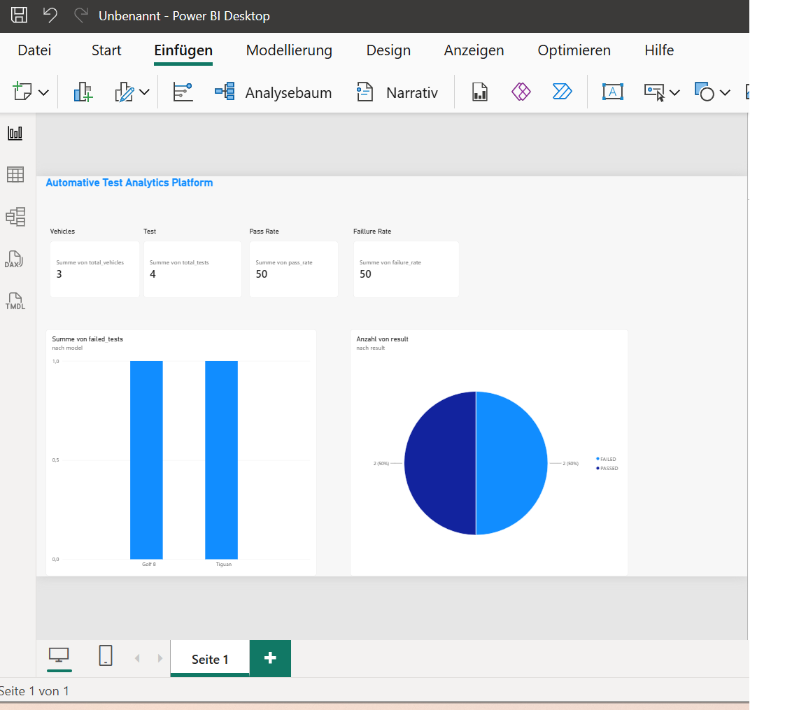

# Automotive SQL & Power BI Analytics Platform

## Project Overview

This portfolio project demonstrates an end-to-end automotive test-data analytics workflow. It began as a SQL learning project with SQLite and was then extended to PostgreSQL, Python/Pandas analytics, Streamlit, Power BI, Git, GitHub, Docker, and Docker Compose.

The application stores vehicles, test cases, test runs, and detected errors. SQL queries combine these relational tables and prepare KPIs for interactive dashboards.

## Technology Stack

- Python
- SQL
- SQLite
- PostgreSQL
- Pandas
- Streamlit
- Power BI
- Docker
- Docker Compose
- Git and GitHub

## Project Development Stages

1. Created the first relational database with SQLite
2. Defined tables, primary keys, and foreign keys
3. Inserted synthetic automotive test data with Python
4. Implemented SQL queries with filters, sorting, aggregations, and joins
5. Calculated analytics KPIs with Pandas
6. Exported reporting datasets to CSV
7. Created an interactive Streamlit dashboard
8. Created a Power BI report
9. Migrated the database layer from SQLite to PostgreSQL
10. Connected Power BI directly to PostgreSQL
11. Created a Docker image for the Python application
12. Started PostgreSQL as a persistent Docker Compose service
13. Published the project to GitHub

## Main Features

- Relational automotive test-data model
- SQLite and PostgreSQL implementations
- Parameterized SQL queries from Python
- Data filtering and sorting
- SQL aggregations and grouped reporting
- Two-table and three-table joins
- KPI calculation with Pandas
- CSV report generation
- Streamlit dashboard
- Power BI dashboard connected to PostgreSQL
- Dockerized Python environment
- PostgreSQL container with persistent Docker storage

## Data Model

### `vehicles`

Stores vehicle information:

- `vehicle_id`
- `vin`
- `model`
- `sw_version`

### `test_cases`

Stores test-case definitions:

- `testcase_id`
- `name`
- `category`

### `test_runs`

Stores executed tests and connects vehicles with test cases:

- `run_id`
- `vehicle_id`
- `testcase_id`
- `result`
- `test_date`

### `errors`

Stores errors associated with test runs:

- `error_id`
- `run_id`
- `severity`
- `description`

## Database Relationships

```text
vehicles (1) --------< test_runs >-------- (1) test_cases
                           |
                           |
                           v
                        errors
```

- One vehicle can have multiple test runs.
- One test case can be used in multiple test runs.
- One test run can have associated error records.

## SQL Skills Demonstrated

- `CREATE TABLE`
- `INSERT INTO`
- `SELECT`
- `WHERE`
- `ORDER BY`
- `COUNT()`
- `GROUP BY`
- `INNER JOIN`
- Multi-table joins
- Primary keys
- Foreign keys
- Parameterized queries

Example three-table join:

```sql
SELECT
    vehicles.model,
    test_cases.name AS test_case,
    test_runs.result,
    test_runs.test_date
FROM test_runs
INNER JOIN vehicles
    ON test_runs.vehicle_id = vehicles.vehicle_id
INNER JOIN test_cases
    ON test_runs.testcase_id = test_cases.testcase_id;
```

## Analytics KPIs

The analytics layer calculates:

- Total vehicles
- Total executed tests
- Pass rate
- Failure rate
- Failed tests per vehicle
- Vehicle with the most failed tests
- Test-result distribution
- Test cases per category

## Application Architecture

```text
SQLite / PostgreSQL
        |
        v
     SQL Queries
        |
        v
  Pandas Analytics
        |
        +----------------------+
        |                      |
        v                      v
Streamlit Dashboard      Power BI Dashboard
        |
        v
 Docker / Docker Compose
```

## Repository Structure

The structure below reflects the current project shown in the repository:

```text
Automotive_SQL_PowerBI/
|
|-- dashboard/
|   |-- __init__.py
|   `-- app.py
|
|-- data/
|
|-- docs/
|   `-- project_plan.md
|
|-- powerbi/
|   `-- README.md
|
|-- reports/
|   |-- output/
|   |   |-- dashboard_summary.csv
|   |   |-- failed_tests_per_vehicle.csv
|   |   |-- PowerBI_Darstellung.png
|   |   |-- Streamlit_dashboard.pdf
|   |   `-- vehicle_test_results.csv
|   `-- export_csv.py
|
|-- src/
|   |-- database/
|   |   |-- __init__.py
|   |   |-- postgres_connection.py
|   |   `-- sqlite_connection.py
|   |-- __init__.py
|   |-- analytics.py
|   |-- create_database.py
|   |-- create_postgres_database.py
|   |-- database_connection.py
|   |-- insert_postgres_data.py
|   |-- insert_sample_data.py
|   |-- sql_queries_postgres.py
|   |-- sql_queries.py
|   `-- test_postgres_connection.py
|
|-- .dockerignore
|-- .gitignore
|-- automotive.db
|-- docker-compose.yml
|-- Dockerfile
|-- README.md
|-- requirements.txt
`-- test_setup.py
```

Generated directories such as `.venv/` and `__pycache__/` are local development artifacts and should not be committed.

## Local Installation

### 1. Clone the repository

```powershell
git clone https://github.com/floratetinou/Automotive-SQL_PowerBI-Analytics.git
cd Automotive-SQL_PowerBI-Analytics
```

### 2. Create and activate a virtual environment

```powershell
python -m venv .venv
.\.venv\Scripts\Activate.ps1
```

### 3. Install dependencies

```powershell
pip install -r requirements.txt
```

## SQLite Workflow

Create the SQLite database and tables:

```powershell
python -m src.create_database
```

Insert the SQLite sample data:

```powershell
python -m src.insert_sample_data
```

Run the SQLite queries if `src/sql_queries.py` is configured for SQLite:

```powershell
python -m src.sql_queries
```

## PostgreSQL Workflow

PostgreSQL must be running before the following commands are used.

Create the PostgreSQL tables:

```powershell
python -m src.create_postgres_database
```

Insert the PostgreSQL sample data:

```powershell
python -m src.insert_postgres_data
```

Run the PostgreSQL queries:

```powershell
python -m src.sql_queries_postgres
```

Run the KPI analytics:

```powershell
python -m src.analytics
```

## Streamlit Dashboard

Start the dashboard from the repository root:

```powershell
streamlit run dashboard/app.py
```

The Streamlit dashboard displays the automotive KPIs and test-analysis tables generated from the database.

[Open the Streamlit dashboard PDF](reports/output/Streamlit_dashboard.pdf)

> GitHub does not embed a PDF with normal Markdown image syntax. The line above therefore links to the PDF instead of attempting to display it as an image.

## Power BI Dashboard

The Power BI report uses PostgreSQL data to visualize:

- Total vehicles
- Total tests
- Pass rate
- Failure rate
- Failed tests per vehicle
- Passed versus failed tests
- Detailed test results
- Interactive filters



## CSV Reporting

Generate or refresh the CSV reporting files with:

```powershell
python -m reports.export_csv
```

The generated reporting files are stored in `reports/output/`.

## Docker

### Build the Python application image

```powershell
docker build -t automotive-analytics .
```

### Start PostgreSQL with Docker Compose

```powershell
docker compose up -d
```

### Check running containers

```powershell
docker ps
```

### View PostgreSQL logs

```powershell
docker logs automotive-postgres
```

### Stop the Compose services

```powershell
docker compose down
```

The configured Docker volume preserves PostgreSQL data when the PostgreSQL container is stopped and restarted.

## Important Docker Networking Note

Inside a Docker container, `localhost` refers to that container, not to the Windows host and not to another container.

When the Python application and PostgreSQL both run through Docker Compose, the Python application must use the PostgreSQL service name from `docker-compose.yml` as the database host, for example:

```text
postgres
```

It must not use:

```text
localhost
```

## Security

- Never commit database passwords, secrets, or tokens.
- Do not hard-code PostgreSQL credentials in `postgres_connection.py`.
- Store credentials in environment variables or a local `.env` file.
- Keep `.env`, `.venv/`, `__pycache__/`, `*.pyc`, and local database files in `.gitignore`.
- Use only synthetic automotive data in a public portfolio repository.
- Do not publish company test data, real VINs, internal screenshots, or proprietary source code.

Example environment variable names:

```text
POSTGRES_HOST=localhost
POSTGRES_PORT=5432
POSTGRES_DB=automotive
POSTGRES_USER=postgres
POSTGRES_PASSWORD=your_password
```

## Learning Outcomes

This project demonstrates practical experience in:

- Relational database modeling
- SQL querying and multi-table joins
- SQLite development
- PostgreSQL development and migration
- Python database integration
- Pandas data analysis
- KPI design
- Streamlit dashboard development
- Power BI reporting
- Docker images and containers
- Docker Compose
- Git and GitHub workflows

## Future Improvements

- Use SQLAlchemy consistently for PostgreSQL connections
- Move every credential to environment variables
- Add validation constraints for test results and severity values
- Add automated tests with `pytest`
- Add a larger synthetic automotive dataset
- Add DAX measures and additional Power BI pages
- Run the Python application and PostgreSQL together with Docker Compose
- Add health checks for the PostgreSQL service
- Add GitHub Actions for automated quality checks

## Author

Flora Tetinou-Sawouo

## Disclaimer

This repository is a learning and portfolio project. The included data should be synthetic and must not contain confidential company information.
